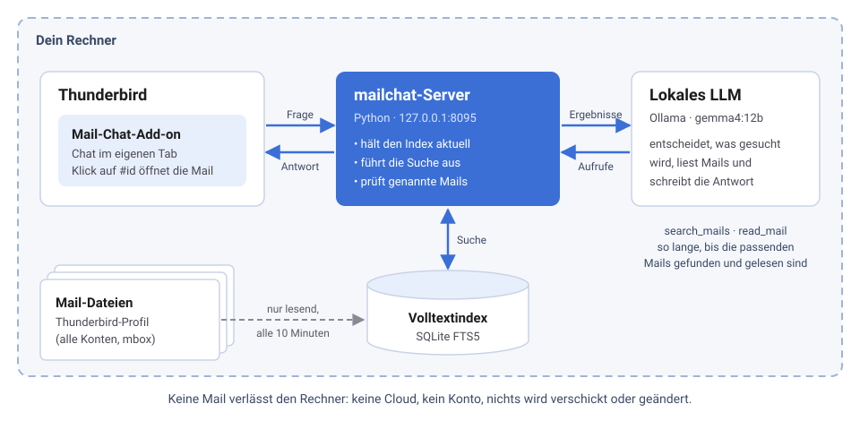

# Mail-Chat für Thunderbird

[English](README.md) · **Deutsch**

Stell deinem eigenen Postfach Fragen in normaler Sprache – *„Bis wann muss ich die
Autoversicherung kündigen?“*, *„Was braucht der Steuerberater noch von mir?“* – und bekomm
eine Antwort mit Verweisen auf die passenden Mails. Gesucht wird von einem Sprachmodell
**auf deinem eigenen Rechner**. Keine Mail verlässt den Computer, es gibt keinen Cloud-Dienst
und kein Konto.


## So funktioniert es



Mail-Chat besteht aus zwei Teilen:

1. **Dem mailchat-Server**, einem kleinen Python-Programm. Er liest die Mail-Dateien von
   Thunderbird (nur lesend), hält einen Volltextindex darüber und spricht mit dem Sprachmodell.
2. **Dem Thunderbird-Add-on.** Es zeigt den Chat in einem Tab und öffnet genannte Mails in
   Thunderbird.

Das Sprachmodell bekommt keine Kopie des Postfachs. Es bekommt zwei Werkzeuge – *Mails
suchen* und *Mail lesen* –, sucht selbst, formuliert um, wenn nichts passt, und nennt jede
verwendete Mail als `#id`. Ein Klick darauf öffnet die Mail in Thunderbird.

## Was du brauchst

| | |
|---|---|
| Thunderbird | 128 oder neuer, unter Windows oder Linux |
| Python | 3.11 oder neuer |
| Ein lokales LLM | [Ollama](https://ollama.com) mit `gemma4:12b` (Standard) oder ein anderer OpenAI-kompatibler Server mit Tool-Calling (llama.cpp, LM Studio, vLLM …) |
| Hardware | `gemma4:12b` braucht eine Grafikkarte mit etwa 10 GB Speicher. Ohne läuft es auf dem Prozessor, aber langsam (rechne mit einer Minute pro Antwort). |
| Mails lokal gespeichert | IMAP-Konten müssen Nachrichten offline vorhalten (in Thunderbird Standard: *Konten-Einstellungen → Synchronisation & Speicherplatz → Nachrichten dieses Kontos auf diesem Computer speichern*). |

macOS sollte funktionieren, ist aber ungetestet; `mailchat autostart` unterstützt es noch nicht.

## Installation unter Windows

Die Windows-Screenshots zeigen eine englische Oberfläche; auf Deutsch heißen die Menüpunkte
wie unter Linux weiter unten.

**1. Ollama und das Modell installieren.** Lade Ollama von
[ollama.com/download](https://ollama.com/download) und installiere es. Öffne dann die
*PowerShell* und gib ein:

```powershell
ollama pull gemma4:12b
```

**2. Python installieren** von [python.org](https://www.python.org/downloads/). Setz im
Installer den Haken bei **„Add python.exe to PATH“**.

**3. Den mailchat-Server installieren** und einrichten. In einem neuen *PowerShell*-Fenster:

```powershell
python -m pip install https://github.com/huppiflupp/mailchat/archive/refs/heads/main.zip
python -m mailchat index
python -m mailchat autostart
python -m mailchat doctor
```

`index` liest die Mails zum ersten Mal ein (bei einem großen Postfach dauert das ein paar
Minuten). `autostart` startet den Server sofort und bei jeder Anmeldung (ein kleiner Eintrag
im Autostart-Ordner). `doctor` prüft alles – jede Zeile sollte `ok` zeigen:


**4. Das Add-on installieren.** Lade `mailchat.xpi` aus dem
[neuesten Release](https://github.com/huppiflupp/mailchat/releases/latest). Öffne in
Thunderbird **☰ → Add-ons und Themes**, klick auf das **Zahnrad** und wähle **Add-on aus
Datei installieren…**:


Wähle `mailchat.xpi`:


Thunderbird fragt nach Berechtigungen: Mails lesen (um genannte Mails zu öffnen), Mails
verfassen (um Entwürfe mit Anhang zu öffnen) und Zugriff auf `127.0.0.1` (den mailchat-Server
auf deinem eigenen Rechner). Klick auf
**Hinzufügen**:


**5. Loschatten.** Der Knopf **Mail-Chat** sitzt jetzt in der Werkzeugleiste (Tastenkürzel
**Strg+Umschalt+K**):


## Installation unter Linux

Die Screenshots zeigen Kubuntu 26.04; auf anderen Distributionen geht es genauso. Getestet
mit dem Snap von Thunderbird; das Paket der Distribution und Flatpak werden ebenfalls gefunden.

**1. Ollama und das Modell installieren:**

```bash
curl -fsSL https://ollama.com/install.sh | sh
ollama pull gemma4:12b
```

**2. Den mailchat-Server installieren** mit [pipx](https://pipx.pypa.io) (Ubuntu/Debian:
`sudo apt install pipx`, Fedora: `sudo dnf install pipx`) und einrichten:

```bash
pipx install https://github.com/huppiflupp/mailchat/archive/refs/heads/main.zip
pipx ensurepath        # einmalig, danach ein neues Terminal öffnen
mailchat index
mailchat autostart
mailchat doctor
```

`autostart` richtet einen systemd-Benutzerdienst (`mailchat.service`) ein, der bei der
Anmeldung startet. Sein Log: `journalctl --user -u mailchat -f`.


**3. Das Add-on installieren** – lade `mailchat.xpi` aus dem
[neuesten Release](https://github.com/huppiflupp/mailchat/releases/latest), dann
**☰ → Add-ons und Themes → Zahnrad → Add-on aus Datei installieren…**:


Bestätige die Berechtigungen mit **Hinzufügen**:


Der Knopf **Mail-Chat** erscheint in der Werkzeugleiste:


## Benutzung

- Frag in deinen eigenen Worten. Das Modell sucht, probiert Varianten und liest die Mails,
  bevor es antwortet. Die grauen Zeilen zeigen, wonach es gesucht hat.
- Ein Klick auf `#id` oder eine Mail-Karte öffnet die Mail in Thunderbird.
- Neue Mails werden alle 10 Minuten eingelesen; **Index aktualisieren** macht es sofort.
- **Neu** beginnt eine neue Unterhaltung.
- **Updates** schaut auf GitHub nach einer neuen Version und installiert sie auf Klick
  (`git pull` in einer Arbeitskopie, sonst pip); der Server startet danach von selbst neu.
  Das Add-on aktualisiert Thunderbird selbst.
- Die Antwort kommt in der Sprache von Thunderbird (Deutsch oder Englisch).

Gute Fragen nennen, worum es in der Mail geht: *„Rechnungen vom Stromanbieter aus diesem
Jahr“*, *„Wann ist der Elternabend?“*, *„der Link zum Upload-Portal vom Steuerberater“*.

### Anhänge, Termine und Mails

- **Anhänge werden mitgelesen**: PDF, Word (.docx, .doc), OpenDocument, Kalenderdateien und
  Bilder. Fotos und gescannte PDFs liest das Sprachmodell, wenn es Bilder versteht (Ollama mit
  `gemma4`), sonst [Tesseract](https://github.com/tesseract-ocr/tesseract). Für PDFs braucht
  es `pdftotext` (poppler), für alte .doc-Dateien LibreOffice – `mailchat doctor` zeigt, was fehlt.
- **Eigene Dateien**: über 📎 oder einfach in den Chat ziehen. *„Trag mir die Veranstaltung
  auf dem Flyer ein“*.
- **Termine**: *„Trag mir den Elternabend in den Kalender ein“*. Datum, Uhrzeit, Ort und
  Programm kommen aus der Mail oder ihrem Anhang. Es öffnet sich Thunderbirds Termin-Dialog
  zum Prüfen und Speichern – **ohne Teilnehmer**, niemand wird eingeladen. Den Dialog öffnet
  das Add-on [ThunderAI Sparks](https://micz.it/thunderbird-addon-thunderai/#sparks);
  ohne Sparks gibt es den Termin als .ics-Datei zum Importieren.
- **Mails mit Anhang**: *„Schick den Flyer an Anna Müller“* oder *„Schick die Rechnung von
  den Stadtwerken an den Steuerberater“*. Die Adresse sucht das Modell in deinen Mails (bei
  mehreren Treffern fragt es nach), schreibt einen kurzen Text und öffnet den Entwurf mit
  Anhang im Verfassen-Fenster. **Abgeschickt wird erst, wenn du auf Senden klickst.**

## Einstellungen

Ohne Konfigurationsdatei nimmt mailchat die Standardwerte unten. Zum Ändern legst du die
Datei an, die `mailchat config` anzeigt:

- Windows: `%APPDATA%\mailchat\config.toml`
- Linux: `~/.config/mailchat/config.toml`

```toml
# Anderes Modell oder anderer Server (jeder OpenAI-kompatible Endpunkt mit Tool-Calling):
llm_model = "gemma4:12b"
llm_url = "http://127.0.0.1:11434/v1/chat/completions"
# llm_api_key = "…"            # falls dein Server einen verlangt

# Nur wenn mailchat das falsche Thunderbird-Profil erwischt:
# profile = "C:\\Users\\ich\\AppData\\Roaming\\Thunderbird\\Profiles\\abcd1234.default-release"

# Bilder in Anhängen: standardmäßig das Sprachmodell oben; versteht es keine Bilder,
# übernimmt Tesseract. Eigenes Bildmodell oder "off" (nur Tesseract):
# vision_url = "http://127.0.0.1:11434/v1/chat/completions"
# vision_model = "gemma4:12b"
# vision = "off"

skip_folders = "spam,junk"     # Ordnernamen, die nie eingelesen werden
reindex = 600                  # Sekunden zwischen zwei Index-Läufen
port = 8095                    # nur zusammen mit dem Add-on ändern
```

Jede Einstellung geht auch als Umgebungsvariable, z. B. `MAILCHAT_LLM_MODEL`. Nach einer
Änderung den Server neu starten: ab- und wieder anmelden, oder unter Linux
`systemctl --user restart mailchat`.

**Kleinere oder größere Modelle.** `gemma4:12b` war in unseren Tests der beste Kompromiss.
Kleinere Modelle (≤ 9B) geben oft nach der ersten Suche auf oder übersehen Details. Ein
größeres Modell oder ein llama.cpp-Server ist über `llm_model` / `llm_url` schnell eingestellt.

**LLM bei Bedarf starten (Linux, für Fortgeschrittene).** Läuft dein LLM als
systemd-Benutzerdienst, der nicht dauernd laufen soll, setz `llm_unit = "mein-llm.service"`.
mailchat startet ihn dann vor einer Frage, entlädt vorher die Modelle von Ollama (beide teilen
sich die GPU) und stoppt ihn nach `llm_idle` Sekunden (Standard 1200) ohne Frage wieder.

## Spracheingabe (optional)

Läuft ein [whisper.cpp](https://github.com/ggml-org/whisper.cpp)-Server auf
`127.0.0.1:8096`, erscheint im Chat ein 🎤-Knopf (oder **Strg+Leertaste**): sprechen, noch
einmal klicken, und die Frage wird abgeschickt. Aufgenommen wird im mailchat-Server; unter
Windows braucht das `python -m pip install sounddevice`, unter Linux wird `pw-record`
(PipeWire) benutzt. Beispiel für den Serverstart:

```bash
whisper-server -m models/ggml-large-v3-turbo-q8_0.bin --host 127.0.0.1 --port 8096
```

## Datenschutz und Sicherheit

- **Alles bleibt auf deinem Rechner.** Der Server lauscht nur auf `127.0.0.1`; Mailinhalte
  gehen an das Sprachmodell, das du einstellst – standardmäßig Ollama auf demselben Rechner.
  Zeigt `llm_url` auf einen anderen Computer oder einen Cloud-Dienst, gehen deine Mails dorthin.
- **Nur lesend.** mailchat ändert, verschiebt oder verschickt nie eine Mail und speichert
  keinen Termin. Es öffnet höchstens einen Entwurf oder Termin-Dialog; senden bzw. speichern
  tust du. Es liest die Dateien von Thunderbird und legt seinen Index unter
  `%LOCALAPPDATA%\mailchat` bzw. `~/.local/share/mailchat` ab. Dateien, die du in den Chat
  ziehst, hält der Server nur im Arbeitsspeicher.
- **Internet nur auf Klick.** Nur der Knopf **Updates** fragt bei GitHub nach der neuesten
  Version; Thunderbird prüft für das Add-on regelmäßig die `updates.json` im Repository.
- **Andere Programme kommen nicht dran.** Der Server antwortet nur Thunderbird-Add-ons und
  lokalen Kommandozeilenwerkzeugen; Webseiten im Browser werden abgewiesen.
- **Mails können Anweisungen enthalten.** Das Modell liest Mailtexte, eine Mail könnte also
  versuchen, die Antwort zu beeinflussen („Prompt Injection“). Das Modell kann suchen, lesen
  und Entwürfe oder Termin-Dialoge öffnen – nichts verschicken, speichern oder löschen. Prüf
  Antworten und vor allem Empfänger und Anhänge eines Entwurfs mit der üblichen Vorsicht.

Die Datenschutzerklärung des Add-ons steht in [PRIVACY.md](PRIVACY.md).

## Grenzen

- Die Suche findet Wörter und Wortanfänge, aber keine Teile in der Wortmitte: „antrag“
  findet „Antragsbuch“, nicht aber „Parteitagsantrag“. Das Modell probiert selbst Varianten.
- Die Volltextsuche kennt von Anhängen nur die Dateinamen; ihren Inhalt liest das Modell
  erst, wenn es eine Mail genauer ansieht. Texterkennung auf Fotos ist nicht fehlerfrei –
  Datum und Uhrzeit im Termin-Dialog bitte prüfen.
- Gefunden wird nur, was Thunderbird lokal vorhält. Die neuere Speicherart *Maildir* wird
  nicht unterstützt, nur das übliche *mbox*.
- Gelöschte Mails verschwinden aus dem Index, nachdem Thunderbird den Ordner komprimiert hat
  (`mailchat index --full` erzwingt es).
- Das Modell kann sich irren. Jede Antwort verweist auf die Mails, auf denen sie beruht –
  bei Wichtigem bitte nachsehen.

## Kommandozeile

```
mailchat doctor                Profil, Index, LLM und Spracheingabe prüfen
mailchat index [--full]        Index aktualisieren (bzw. komplett neu aufbauen)
mailchat search WÖRTER         Volltextsuche ohne LLM
mailchat ask FRAGE             eine Frage, Antwort im Terminal
mailchat chat                  Chat im Terminal
mailchat serve                 Server im Vordergrund laufen lassen
mailchat autostart [--remove]  Server bei der Anmeldung starten bzw. das abschalten
mailchat config                geltende Einstellungen anzeigen
```

Unter Windows `python -m mailchat …` benutzen, falls `mailchat` nicht gefunden wird.

## Deinstallieren

1. `mailchat autostart --remove`
2. `pipx uninstall mailchat` (Linux) bzw. `python -m pip uninstall mailchat` (Windows)
3. Das Add-on in Thunderbird entfernen und den Index-Ordner löschen
   (`%LOCALAPPDATA%\mailchat` bzw. `~/.local/share/mailchat`).

## Entwicklung

`tools/demo_profile.py` baut ein Thunderbird-Profil mit erfundenen Mails – das zeigen die
Screenshots. Das Add-on liegt in `addon/`; packen mit

```bash
cd addon && zip -r ../mailchat.xpi manifest.json *.js *.html *.css *.svg _locales
```

## Lizenz

[MIT](LICENSE)
