# Mail Chat for Thunderbird

**English** · [Deutsch](README.de.md)

Ask your own mailbox questions in plain language – *“When do I have to cancel my car
insurance?”*, *“What does the tax advisor still need from me?”* – and get an answer with
links to the matching mails. A language model on **your own computer** does the searching.
No mail leaves your machine, there is no cloud service and no account.

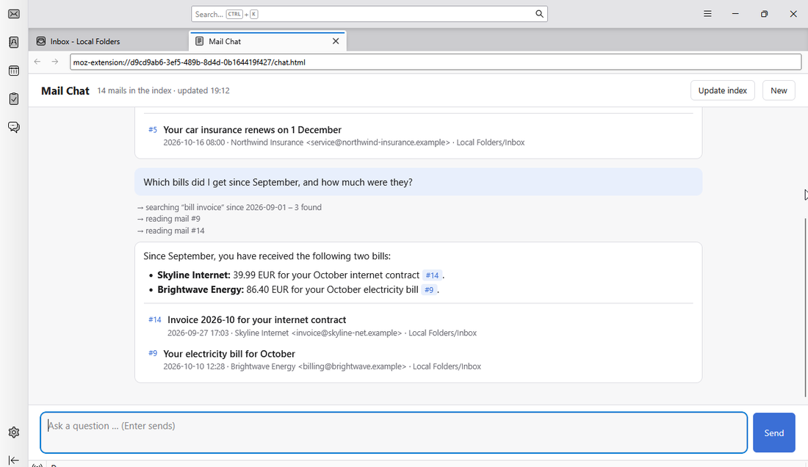

## How it works

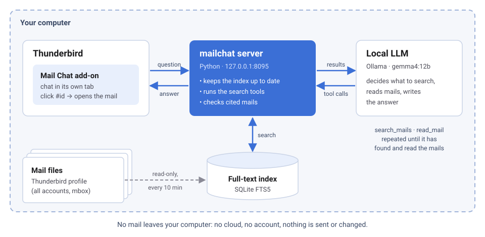

Mail Chat has two parts:

1. **The mailchat server**, a small Python program. It reads Thunderbird's mail files
   (read-only), keeps a full-text index of them and talks to the language model.
2. **The Thunderbird add-on.** It opens the chat in a tab and opens cited mails in Thunderbird.

The language model gets no copy of your mailbox. It gets two tools – *search mails* and
*read mail* – searches by itself, rephrases when nothing fits and cites every mail it uses
as `#id`. Clicking it opens the mail in Thunderbird.

## What you need

| | |
|---|---|
| Thunderbird | 128 or newer, on Windows or Linux |
| Python | 3.11 or newer |
| A local LLM | [Ollama](https://ollama.com) with `gemma4:12b` (default), or any OpenAI-compatible server with tool calling (llama.cpp, LM Studio, vLLM …) |
| Hardware | `gemma4:12b` wants a graphics card with about 10 GB of memory. Without one it runs on the CPU, but slowly (expect a minute per answer). |
| Mail stored locally | IMAP accounts must keep messages offline (default in Thunderbird: *Account Settings → Synchronization & Storage → Keep messages for this account on this computer*). |

macOS should work but is untested; `mailchat autostart` does not support it yet.

## Installation on Windows

**1. Install Ollama and the model.** Download Ollama from [ollama.com/download](https://ollama.com/download)
and install it. Then open *PowerShell* and run:

```powershell
ollama pull gemma4:12b
```

**2. Install Python** from [python.org](https://www.python.org/downloads/). In the installer,
tick **“Add python.exe to PATH”**.

**3. Install the mailchat server** and set it up. In a new *PowerShell* window:

```powershell
python -m pip install https://github.com/huppiflupp/mailchat/archive/refs/heads/main.zip
python -m mailchat index
python -m mailchat autostart
python -m mailchat doctor
```

`index` reads your mail for the first time (a large mailbox takes a few minutes).
`autostart` starts the server now and at every login (a small entry in the Startup folder).
`doctor` checks everything – each line should say `ok`:

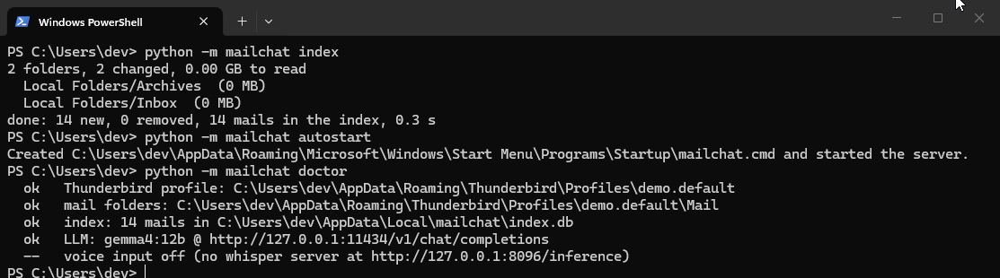

**4. Install the add-on.** Download `mailchat.xpi` from the
[latest release](https://github.com/huppiflupp/mailchat/releases/latest). In Thunderbird
open **☰ → Add-ons and Themes**, click the **gear** and choose **Install Add-on From File…**:

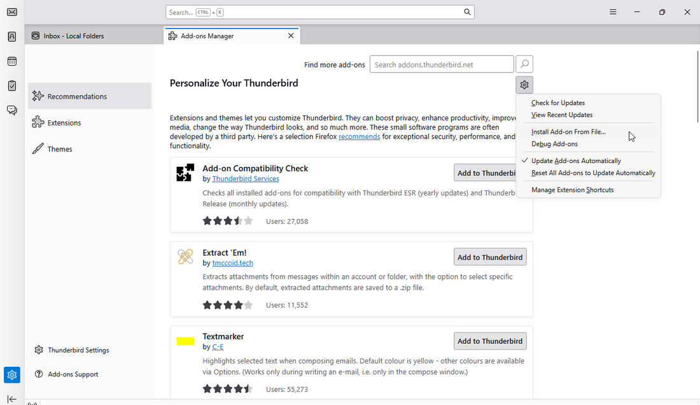

Select `mailchat.xpi`:

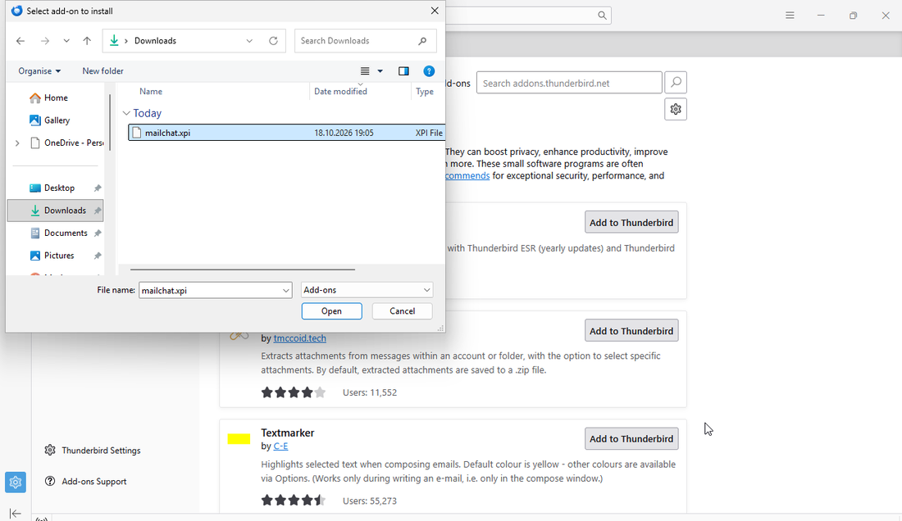

Thunderbird asks for permissions: reading your mails (to open cited mails) and access to
`127.0.0.1` (the mailchat server on your own computer). Click **Add**:

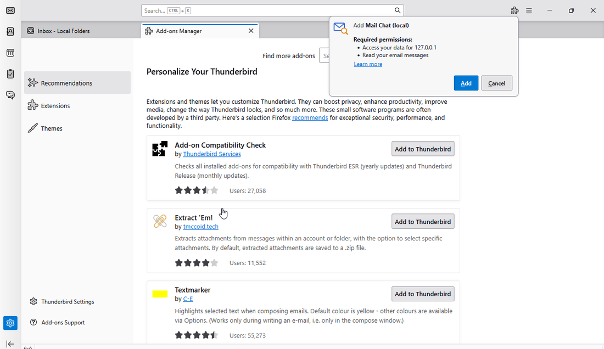

**5. Start chatting.** The **Mail Chat** button now sits in the toolbar (shortcut
**Ctrl+Shift+K**):

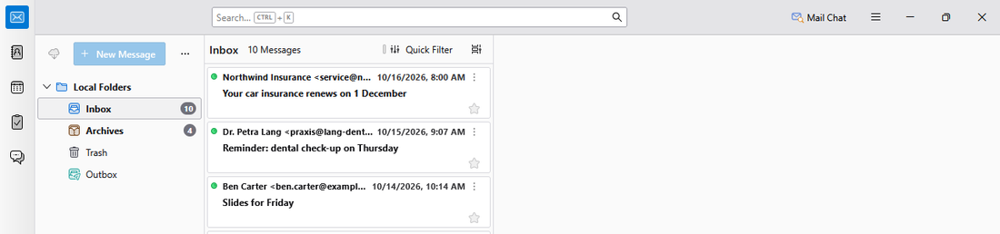

## Installation on Linux

The screenshots show Kubuntu 26.04 with a German user interface; the steps are the same on
other distributions. Tested with the Snap of Thunderbird; the distribution package
and Flatpak are found as well.

**1. Install Ollama and the model:**

```bash
curl -fsSL https://ollama.com/install.sh | sh
ollama pull gemma4:12b
```

**2. Install the mailchat server** with [pipx](https://pipx.pypa.io) (Ubuntu/Debian:
`sudo apt install pipx`, Fedora: `sudo dnf install pipx`) and set it up:

```bash
pipx install https://github.com/huppiflupp/mailchat/archive/refs/heads/main.zip
pipx ensurepath        # once; then open a new terminal
mailchat index
mailchat autostart
mailchat doctor
```

`autostart` installs a systemd user service (`mailchat.service`) that starts at login.
Its log: `journalctl --user -u mailchat -f`.

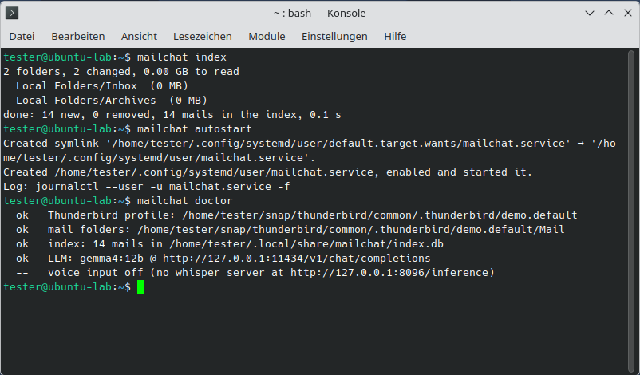

**3. Install the add-on** – download `mailchat.xpi` from the
[latest release](https://github.com/huppiflupp/mailchat/releases/latest), then
**☰ → Add-ons and Themes → gear → Install Add-on From File…**:

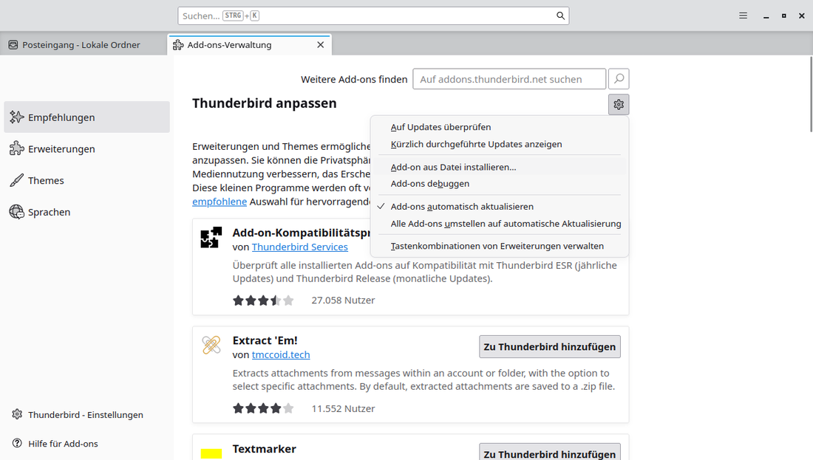

Confirm the permissions with **Add**:

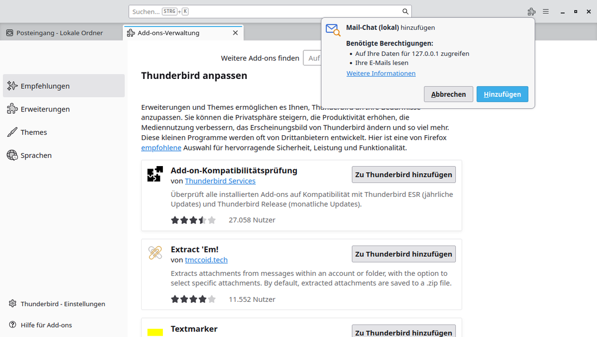

The **Mail Chat** button appears in the toolbar:

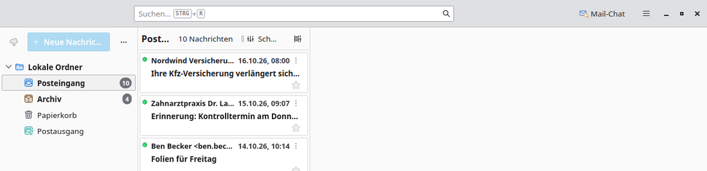

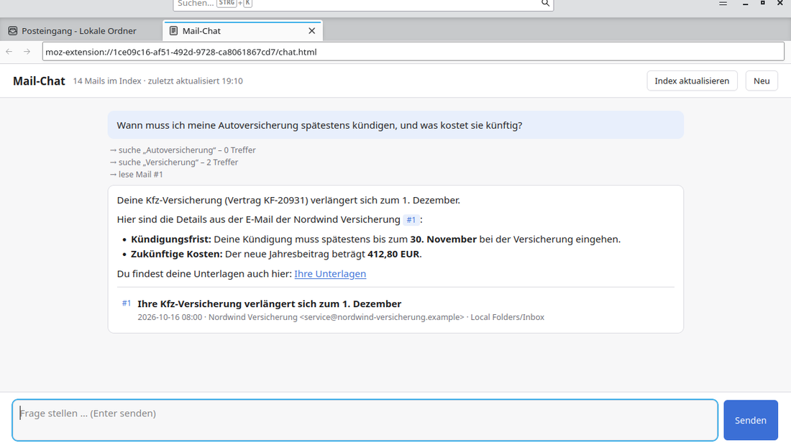

## Using it

- Ask in your own words. The model searches, tries variants and reads the mails before it
  answers. The grey lines show what it searched for.
- Click `#id` or a mail card to open that mail in Thunderbird.
- New mail is indexed every 10 minutes; **Update index** does it right away.
- **New** starts a fresh conversation.
- The answer follows Thunderbird's language (German or English).

Good questions name what the mail is about: *“invoices from the electricity company this
year”*, *“when is the parents' evening?”*, *“the link to the upload portal from the tax
advisor”*.

## Configuration

Without a config file mailchat uses the defaults below. To change something, create the file
shown by `mailchat config`:

- Windows: `%APPDATA%\mailchat\config.toml`
- Linux: `~/.config/mailchat/config.toml`

```toml
# Use a different model or server (any OpenAI-compatible endpoint with tool calling):
llm_model = "gemma4:12b"
llm_url = "http://127.0.0.1:11434/v1/chat/completions"
# llm_api_key = "…"            # if your server needs one

# Only if mailchat picks the wrong Thunderbird profile:
# profile = "C:\\Users\\me\\AppData\\Roaming\\Thunderbird\\Profiles\\abcd1234.default-release"

skip_folders = "spam,junk"     # folder names that are never indexed
reindex = 600                  # seconds between index updates
port = 8095                    # change only together with the add-on
```

Every setting can also be given as an environment variable, e.g. `MAILCHAT_LLM_MODEL`.
After a change restart the server: log out and back in, or on Linux
`systemctl --user restart mailchat`.

**Smaller or bigger models.** `gemma4:12b` was the best trade-off in our tests. Smaller
models (≤ 9B) often give up after the first search or overlook details. A larger model or a
llama.cpp server is an easy switch via `llm_model` / `llm_url`.

**Starting the LLM on demand (Linux, advanced).** If your LLM runs as a systemd user unit
that you don't want to keep running, set `llm_unit = "my-llm.service"`. mailchat then starts
it before a question, unloads Ollama's models first (they share the GPU) and stops it again
after `llm_idle` seconds (default 1200) without a question.

## Voice input (optional)

With a [whisper.cpp](https://github.com/ggml-org/whisper.cpp) server running on
`127.0.0.1:8096`, a 🎤 button appears in the chat (or press **Ctrl+Space**): speak, click
again, and the question is sent. Recording happens in the mailchat server; on Windows it
needs `python -m pip install sounddevice`, on Linux `pw-record` (PipeWire) is used.
Example server start:

```bash
whisper-server -m models/ggml-large-v3-turbo-q8_0.bin --host 127.0.0.1 --port 8096
```

## Privacy and security

- **Everything stays on your computer.** The server listens on `127.0.0.1` only; mail
  content goes to the language model you configure – by default Ollama on the same machine.
  If you point `llm_url` at another computer or a cloud service, your mail goes there.
- **Read-only.** mailchat never changes, moves or sends mail. It reads Thunderbird's files
  and keeps its index in `%LOCALAPPDATA%\mailchat` or `~/.local/share/mailchat`.
- **Other programs can't ask it.** The server only answers requests from Thunderbird
  add-ons and local command-line tools; web pages in your browser are refused.
- **Mails can contain instructions.** The model reads mail text, so a mail could try to steer
  its answer (“prompt injection”). The model can only search and read – it cannot send,
  delete or open anything – but treat answers with the usual care.

See [PRIVACY.md](PRIVACY.md) for the add-on's privacy policy.

## Limitations

- Search finds words and word beginnings, not parts in the middle of words
  (“invoice” finds “invoices”, but German “antrag” does not find “Parteitagsantrag”).
  The model tries variants on its own.
- Attachment *contents* (PDF, Word …) are not read, only their file names.
- Only mail that Thunderbird keeps locally is found. Thunderbird's newer *maildir* storage
  is not supported, only the default *mbox*.
- Deleted mail disappears from the index after Thunderbird compacts the folder
  (`mailchat index --full` forces it).
- The model can be wrong. Every answer links the mails it is based on – check them for
  anything important.

## Command line

```
mailchat doctor                check profile, index, LLM and voice input
mailchat index [--full]        update the index (or rebuild it completely)
mailchat search WORDS          full-text search without the LLM
mailchat ask QUESTION          one question, answer in the terminal
mailchat chat                  interactive chat in the terminal
mailchat serve                 run the server in the foreground
mailchat autostart [--remove]  start the server at login, or stop doing so
mailchat config                show the settings in effect
```

On Windows use `python -m mailchat …` if `mailchat` is not found.

## Uninstall

1. `mailchat autostart --remove`
2. `pipx uninstall mailchat` (Linux) or `python -m pip uninstall mailchat` (Windows)
3. Remove the add-on in Thunderbird and delete the index folder
   (`%LOCALAPPDATA%\mailchat` or `~/.local/share/mailchat`).

## Development

`tools/demo_profile.py` builds a Thunderbird profile with invented mails – that is what the
screenshots show. The add-on lives in `addon/`; pack it with

```bash
cd addon && zip -r ../mailchat.xpi manifest.json *.js *.html *.css *.svg _locales
```

## License

[MIT](LICENSE)
